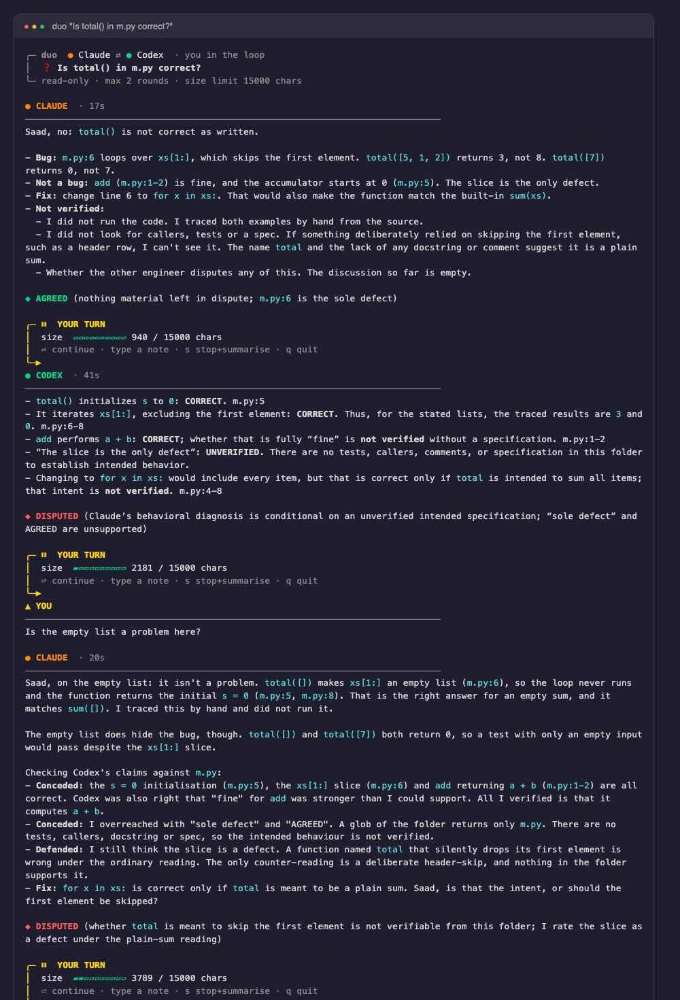

# claude-codex-pairing

`duo` lets two coding agents, Claude Code and OpenAI Codex, **discuss a question in turns**, check each other's
claims against your actual files, and end with one best answer plus a list of what is still unverified.

It is a single bash script on top of the two official CLIs. No servers, no API keys of its own.



*A real run on a small seeded bug: Claude opens, Codex disputes the over-claim ("sole defect", "AGREED"),
Claude concedes it, the human asks about the empty list, and the final answer follows
([full run](docs/screenshot-full.png)). The image is the run's output rendered in a browser, not a live terminal capture.*

## Why

One model answering alone can be confidently wrong. Two models answering in parallel can share the same
blind spot. `duo` makes them argue instead: every claim gets marked CORRECT, WRONG or UNVERIFIED with
`file:line` evidence, and each side has to concede or defend.

## How it works

1. Claude opens with an answer and evidence.
2. Codex checks each claim, answers, and adds what is missing.
3. Claude checks Codex the same way, concedes what is right, defends what is right.
4. Steps 2 and 3 repeat until both end with `STATUS: AGREED` or the round limit is reached.
5. A final summary lists: best answer, agreed and verified, still disputed or unverified, and concrete
   commands to verify the rest yourself.

You stay in the loop: after every turn `duo` pauses and you can press Enter to continue, type a note that
joins the discussion (both agents must answer it, and still verify any facts in it), press `s` to stop and
summarise, or `q` to quit. A size gauge warns you when the argument is getting too big, and `-m` sets a hard limit.

Both agents run **read-only**: Claude with `--permission-mode plan` and the tools Read, Grep and Glob,
Codex with `-s read-only`. Each turn has a 240 second limit.

## Install

Requirements: the `claude` and `codex` CLIs (logged in), `perl`, bash or zsh.

```bash
git clone https://github.com/mohammadsaadshafiq/claude-codex-pairing.git
cd claude-codex-pairing && ./install.sh
```

The installer copies `duo` to `~/.local/bin`, adds that folder to your PATH in `~/.zshrc` or `~/.bashrc` if needed
(only once), and runs `duo --doctor` to check your setup. Open a new terminal afterwards.

## Use

Run it inside the project you want to discuss:

```bash
duo "Is the token refresh in auth.ts safe against a race?"
duo -r 4 "Does this migration lose data on rollback?"   # up to 4 rounds (default 5)
duo -m 8000 "..."                                        # warn and stop when the argument exceeds 8000 chars
duo -a "..."                                             # automatic, no pauses
duo --doctor                                             # check installation
```

Every run is saved as Markdown in `~/.duo/`; copy it with `pbcopy < ~/.duo/<file>.md`.
Colours are off when output is piped or `NO_COLOR=1` is set.

## Shared instructions (recommended)

Codex reads `AGENTS.md`, Claude Code reads `CLAUDE.md`. Keep one source of truth: put your rules in
`AGENTS.md` and make `CLAUDE.md` contain the single line `@AGENTS.md`. See [`examples/`](examples).

## Limits, stated plainly

- Agreement is not proof. Two models can agree and both be wrong. The final section tells you what to run yourself.
- Because both agents are read-only, neither can run your code or tests. Claims about behaviour are hand traces
  until you execute them.
- A model can mark `STATUS: AGREED` too early. Read the discussion, not only the verdict.
- It makes several model calls per question, so it uses more of your quota than a single answer.
- Tested so far on small seeded-bug examples (an off-by-one in a loop), not yet on large real codebases.
- The human pauses were tested with scripted input, not by typing in a live terminal.

## Related projects

- [openai/codex-plugin-cc](https://github.com/openai/codex-plugin-cc): official Codex plugin inside Claude Code (reviews, adversarial review).
- [brettchangus/cross-review](https://github.com/brettchangus/cross-review): independent reviews reconciled against the source.
- [atompilot/claude-code-cross-review](https://github.com/atompilot/claude-code-cross-review): write, review, fix loop.

## License

MIT, see [LICENSE](LICENSE).
