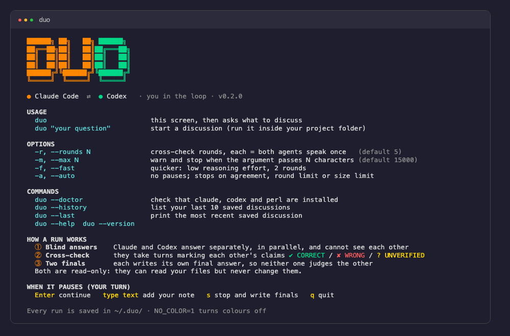

# claude-codex-pairing

**`duo`** makes two coding agents, Claude Code and OpenAI Codex, work on your question together: they answer
separately, then check each other's claims against your actual files, then each writes its own final answer.
You stay in the loop the whole time and can step in, steer, or stop.

It is one bash script on top of the two official CLIs. No servers, no API keys of its own.



## How a run works

| Phase | What happens |
|---|---|
| ① **Blind answers** | Claude and Codex answer **separately and in parallel**. Neither can see the other, so neither anchors on the other. |
| ② **Cross-check** | They take turns. Each marks the other's claims `✔ CORRECT` / `✘ WRONG` / `? UNVERIFIED` with `file:line` evidence, answers your notes, and **must name one thing that could be wrong in its own position**. Who goes first is random. |
| ③ **Two finals** | Each writes its **own** final answer, separately, so neither model judges the other's. Where the two finals differ, you check it yourself. |

A live status line shows which agent is still working and for how long, and the run ends with a process summary
(time per phase, number of model calls). Both agents are **read-only**: Claude with `--permission-mode plan` and
Read/Grep/Glob only, Codex with `-s read-only`.


*A real run on a small seeded bug ([full run](docs/screenshot-full.png)): both blind answers, Claude and Codex
cross-checking, the human asking about the empty list, then the two finals. In the cross-check Codex retracted its own
unconditional "No" as an over-claim. The images are the run's output rendered in a browser, not live terminal captures.*

## You in the loop

After every turn `duo` pauses:

| Key | Effect |
|---|---|
| `Enter` | continue |
| any text | your note joins the discussion; both agents must answer it, and still verify any facts in it |
| `s` | stop and write the finals |
| `q` | quit without finals |

A size gauge warns when the argument is getting too big; `-m` sets a hard limit.

## Install

Requirements: the `claude` and `codex` CLIs (logged in), `perl`, bash or zsh.

```bash
git clone https://github.com/mohammadsaadshafiq/claude-codex-pairing.git
cd claude-codex-pairing && ./install.sh
```

The installer copies `duo` to `~/.local/bin`, adds that folder to your PATH in `~/.zshrc` or `~/.bashrc` if needed
(once), and runs `duo --doctor`. Open a new terminal afterwards.

## Commands

```text
duo                      start screen with all commands, then asks what to discuss
duo "your question"      start a discussion (run it inside your project folder)

-r, --rounds N           cross-check rounds, each = both agents speak once (default 5)
-m, --max N              warn and stop when the argument passes N characters (default 15000)
-f, --fast               quicker: low reasoning effort, 2 rounds
-a, --auto               no pauses; stops on agreement, round limit or size limit

duo --doctor             check that claude, codex and perl are installed
duo --history            list your last 10 saved discussions
duo --last               print the most recent saved discussion
duo --help | --version
```

Every run is saved as Markdown in `~/.duo/` (copy with `pbcopy < ~/.duo/<file>.md`).
Colours are off when output is piped or `NO_COLOR=1` is set.

## Why it can be slow

Every turn is a full agent session (start the CLI, read files with tools, think, answer), turns in phase ② run one
after another, and later turns resend the whole discussion. Codex at high reasoning effort is slower than Claude.
`--fast` lowers the reasoning effort and limits the rounds; the two blind answers and the two finals already run in
parallel. A typical `--fast` run on a tiny project took about 1.5 minutes for 6 model calls.

## Shared instructions (recommended)

Codex reads `AGENTS.md`, Claude Code reads `CLAUDE.md`. Keep one source of truth: put your rules in `AGENTS.md`
and make `CLAUDE.md` contain the single line `@AGENTS.md`. See [`examples/`](examples).

## Limits, stated plainly

- Agreement is not proof. Two models can agree and both be wrong. Each final answer ends with what to run yourself.
- Both agents are read-only, so neither can run your code or tests. Claims about behaviour are hand traces until you
  execute them.
- The blind round and the random order reduce, but do not remove, the tendency of a model to agree with an answer
  that is already on the page. Read the discussion, not only the `AGREED` label.
- Several model calls per question use more of your quota than a single answer.
- Tested on small seeded-bug examples (an off-by-one in a loop), not yet on large real codebases.
- The human pauses were tested with scripted input, and the live status line under a pseudo-terminal, not by hand
  in a real terminal session.

## Related projects

- [openai/codex-plugin-cc](https://github.com/openai/codex-plugin-cc): official Codex plugin inside Claude Code (reviews, adversarial review).
- [brettchangus/cross-review](https://github.com/brettchangus/cross-review): independent reviews reconciled against the source.
- [atompilot/claude-code-cross-review](https://github.com/atompilot/claude-code-cross-review): write, review, fix loop.

## License

MIT, see [LICENSE](LICENSE).
